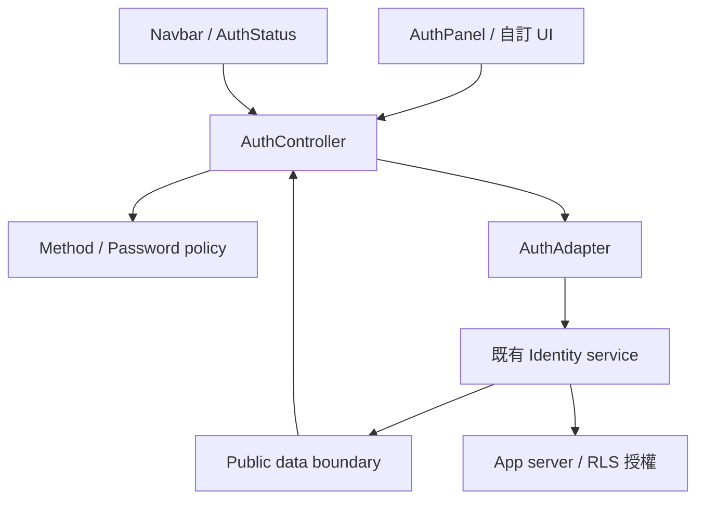
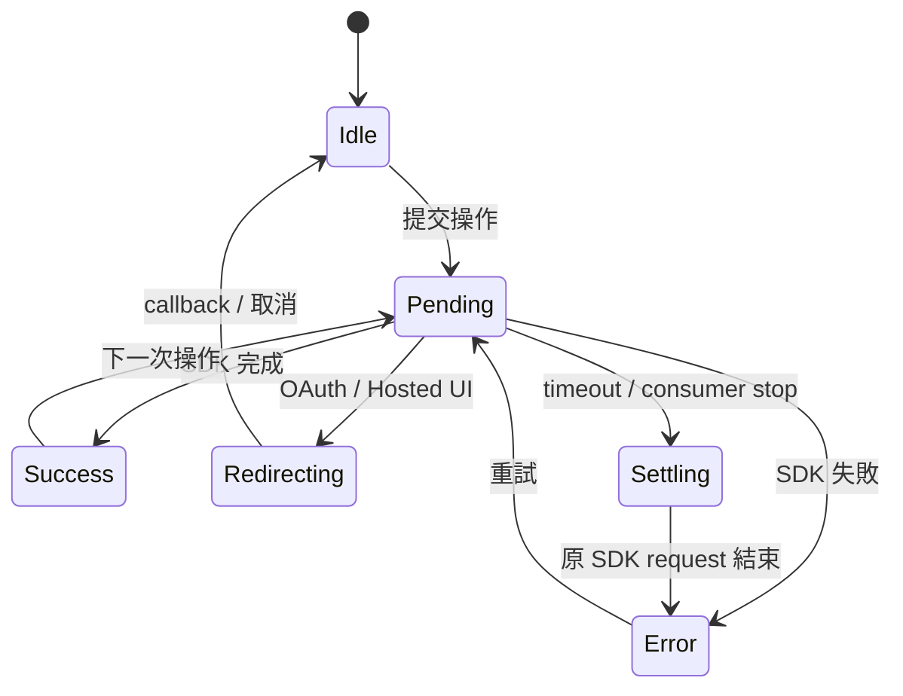

# 架構與資料界線

Core 負責共用狀態與規則。Identity provider 負責帳號、密碼儲存、OAuth、cookie／token 與 server session。Navbar 與表單讀取同一 controller，避免各自推測登入結果。

## 每一層改什麼

| 層              | 位置                           | 責任                                                                |
| --------------- | ------------------------------ | ------------------------------------------------------------------- |
| Public contract | src/types.ts                   | inputs、capabilities、results、唯讀 session／operation              |
| Policy          | src/config.ts、src/password.ts | methods、密碼規則、timer 範圍、redirect                             |
| Public boundary | src/boundary.ts                | runtime shape validation、重建 allowlist、移除額外 SDK 欄位、freeze |
| State           | src/controller.ts              | SDK mutation queue、session 競態、settling、cooldown、expiry、事件  |
| React           | src/react                      | 表單 scope、accessibility、focus、slots、語系                       |
| Adapter         | src/adapters                   | 驗證已啟用的 SDK methods，翻譯 service protocol                     |
| Server helpers  | src/server                     | 自建 backend 的安全工具；app handler 必須實際呼叫                   |

/react entry 與 components 保留 `"use client"`。ESM 與 declarations 使用 TypeScript compiler 輸出。Core 不 import React、Node crypto 或 identity SDK；SDK 僅在 devDependencies 驗證 type compatibility。

## Session 與 operation

兩者是獨立狀態。寄送驗證信成功不代表取得會員 session。

| Session status | 顯示條件                                               |
| -------------- | ------------------------------------------------------ |
| checking       | 初始查詢、身份變更、等待身份操作；session 為 null      |
| authenticated  | server 已驗證、未過期、符合 email policy 的 session    |
| anonymous      | server 無 session，或目前沒有可接受的 session          |
| unavailable    | 查詢失敗、timeout、尚未解除的失敗登出；session 為 null |

`operation.id` 讓多個 panel 區分提交者；只有該 panel 會 focus 該錯誤。idle 的 id 為 0。settling 期間 signOut 可排隊，其他 mutation 被拒絕；lifecycle 變更後，完成的舊操作只會清理等待狀態。

## SDK queue 與身份隔離

1. mutation 在 await 前同步鎖定。等待的是實際 SDK promise，不能用 timeout 的 race result 解除鎖。
2. timeout 先回傳安全錯誤、清除 UI session，phase 進入 settling。SDK 不回覆時保持鎖定；package 無法取消不支援 AbortSignal 的遠端操作。
3. signOut 先隱藏會員內容，排在已開始的 mutation 後。呼叫端即使 unmount，這個明確要求的 SDK 登出仍會執行；舊 UI callback 不再生效。
4. refresh、mutation、身份事件與 lifecycle 各有版本。SDK 通知先清 UI，再於下一個 task 重查；mutation 尚未結束時不發動背景 SDK read，避免重入 service lock。
5. 操作期間身份改變時，完成前重新取得 canonical session。舊 A 的結果不能回傳／發出成功事件而誤導 host，也不能覆蓋新 B。
6. 登出失敗／timeout 記住該 user ID。background refresh 可接受 B 或 null，但不能讓 A 回到 UI；未知 user ID 時隱藏所有背景身份。使用者明確 refresh()、重新登入成功或 SDK 登出最終成功可解除。focus／visibility、expiry、SDK 通知都使用 background 模式。
7. 非身份操作若使初始 read 過期，或切換帳號未成功替換原 session，會安排新的 canonical read，保留操作 feedback。
8. 最後一個 consumer stop 會 unsubscribe、取消等待 read、使舊 caller 失效、清除 expiry timer；重新 start 可安全用於 React StrictMode。SDK barrier 與登出隱藏規則跨 lifecycle 保留。

有期限的 session 由 timer 在到期時先清 UI 再重查；React focus／visibility 補做檢查。背景 tab 可能暫停 timer，server 必須獨立拒絕過期 session。

## 表單 scope 與公開資料

AuthPanel 的工作屬於 controller／view／resetToken scope。切換 scope 會換掉 form、清除秘密輸入並忽略舊結果的導頁。更換 controller 也清除 email。成功 resend code 會使舊 OTP 輸入失效，失敗保留輸入。

TypeScript structural typing 不會移除 runtime 的額外欄位。所有 adapter 回覆都經 boundary 重新建立 allowlisted session、user、outcome、error；snapshot 的巢狀值及公開設定皆唯讀、凍結。這能避免意外攜帶 raw SDK token，不能證明惡意 adapter 沒有把秘密放進允許的字串欄位。

AuthGate 與 snapshot 是 presentation。Server route、Server Action、RPC、RLS 必須驗證身份與資料 owner。Host 的資料 store 必須跟著帳號切換清空／切 namespace；controller 不操作專案資料庫或 IndexedDB。

## Code graph

[CODE_GRAPH.md](CODE_GRAPH.md) 與 [code-graph.json](code-graph.json) 由 scripts/code-graph.ts 解析實際 TypeScript modules、宣告與可靜態解析的 call edges。它不是 runtime profiler，不保證涵蓋 callback 或多型 adapter dispatch。CI 檢查產物 freshness。
