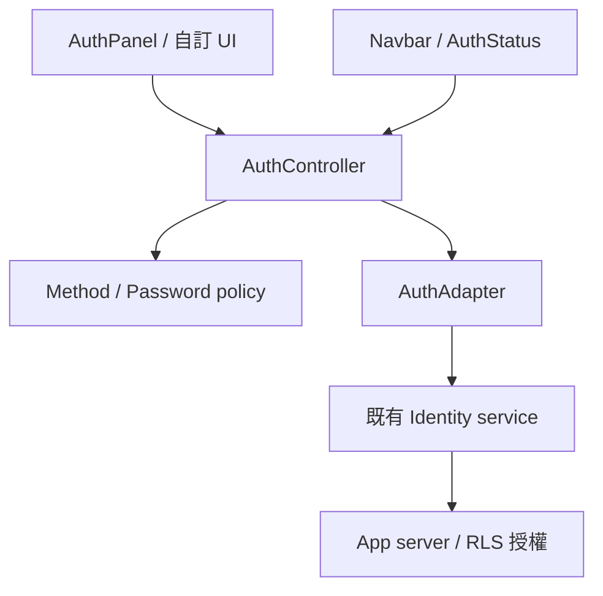
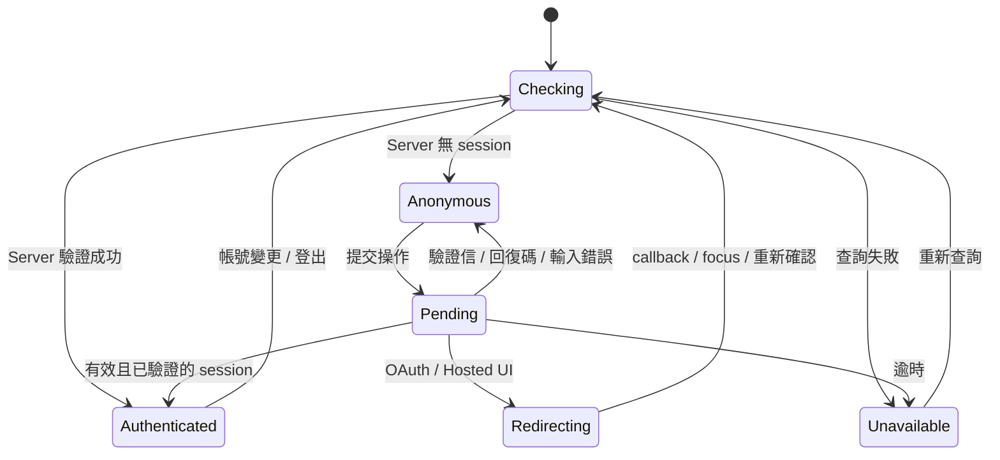

# 架構與資料界線

Core 只負責可以共用的狀態與規則。Identity provider 負責帳號、密碼儲存、OAuth、cookie／token 與 server session。React UI 透過同一個 controller 更新，因此 navbar 與登入表單不需要各自猜測登入是否成功。

## 每一層改什麼

| 層              | 位置                               | 責任                                          |
| --------------- | ---------------------------------- | --------------------------------------------- |
| Public contract | `src/types.ts`                     | inputs、capabilities、results、safe session   |
| Policy          | `src/config.ts`, `src/password.ts` | 開啟的 methods、新密碼規則、local redirect    |
| State           | `src/controller.ts`                | 單一 mutation、競態防護、逾時、cooldown、事件 |
| React           | `src/react`                        | forms、accessibility、focus、slots、語系      |
| Adapter         | `src/adapters`                     | 翻譯各 SDK 的驗證與回覆格式                   |
| Server helpers  | `src/server`                       | 自建 backend 可用的安全工具；app 需實際呼叫   |

`/react` entry 與 components 保留 `"use client"`。ESM 與 declarations 用 TypeScript compiler 輸出，不會把 Node crypto 或所有 identity SDK 打包進 browser。SDK 僅在 devDependencies 用於 contract typecheck。

## 狀態流程

圖中的 Pending／Redirecting 是 operation.phase；其餘是 session status，兩者在 snapshot 中分開。例如寄送驗證信成功不等於取得會員 session。

## 非同步與資料隔離

1. 同一個 controller 一次只執行一個 mutation。pending 在 await 前同步設定，擋住同一個 event loop 的重複提交。
2. 每個 mutation、refresh、identity change 與 lifecycle 都有版本。舊 refresh 不能覆蓋新 session，也不能在登出後把舊會員帶回畫面。
3. provider 發出身份變更時，先清掉 UI session，再於 下一個 task 重新查詢。避免 Supabase callback 的 SDK lock 重入。
4. 元件最後一個 consumer 卸載時 unsubscribe，取消等待並使未完成結果失效。React StrictMode 可重新 start。
5. SDK 若不支援 AbortSignal，timeout 無法保證遠端 request 已取消。UI 顯示逾時並清除 session，使用者應先重新確認 server session。
6. host 的會員資料 store 必須跟著帳號切換清空／切 namespace；controller 不直接操作專案資料庫或 IndexedDB。

## 安全界線

`AuthGate`、`AuthStatus` 與 getSnapshot 都是 presentation。Server route、Server Action、RPC、RLS 必須獨立驗證身份與資料 owner。任何修改 browser JavaScript 的使用者都能繞過 UI 限制。

adapter 僅輸出 allowlisted user fields。未知 provider errors 不原樣顯示；events 不包含 email、password、code、token。React input state 只在目前 view 存活；切頁／成功後清除秘密欄位。

## Code graph

[CODE_GRAPH.md](CODE_GRAPH.md) 與 [code-graph.json](code-graph.json) 由 `scripts/code-graph.ts` 解析實際 TypeScript modules、宣告與能靜態解析的 call edges。它不是 runtime profiler，也不保證涵蓋 callback 或多型 adapter dispatch。CI 會檢查產物是否過期。
