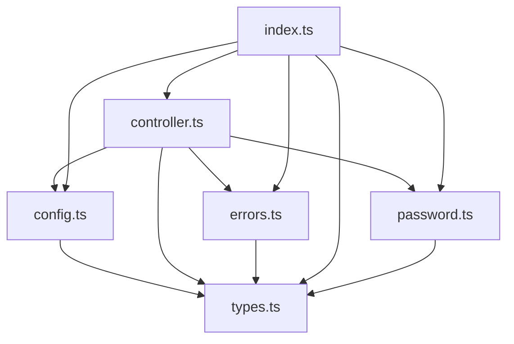
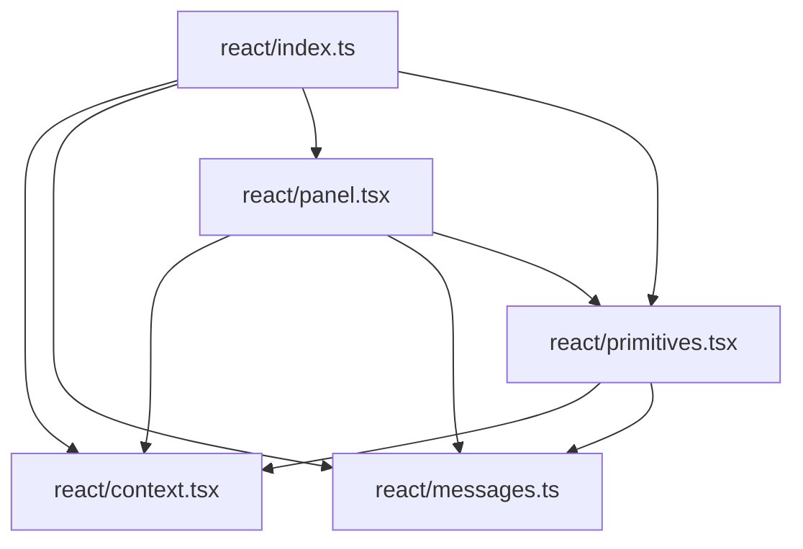
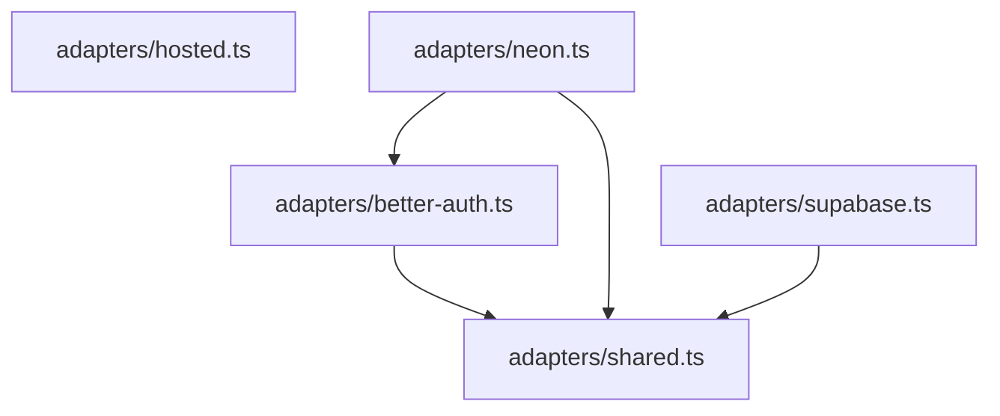
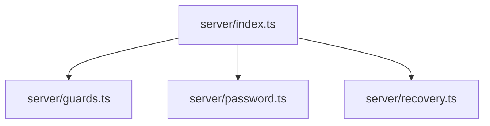

# Code graph

由 TypeScript compiler API 從 `src/` 產生；執行 `bun run graph` 更新。JSON 同時包含宣告與可靜態解析的 function calls；callback、動態 adapter dispatch 與 runtime data flow 需配合 [ARCHITECTURE.md](ARCHITECTURE.md) 閱讀。

## core

| Module | 跨層依賴 |
| --- | --- |
| `src/config.ts` | — |
| `src/controller.ts` | — |
| `src/errors.ts` | — |
| `src/index.ts` | — |
| `src/password.ts` | — |
| `src/types.ts` | — |

## react

| Module | 跨層依賴 |
| --- | --- |
| `src/react/context.tsx` | `src/controller.ts` |
| `src/react/index.ts` | — |
| `src/react/messages.ts` | `src/types.ts` |
| `src/react/panel.tsx` | `src/password.ts`, `src/types.ts` |
| `src/react/primitives.tsx` | — |

## adapters

| Module | 跨層依賴 |
| --- | --- |
| `src/adapters/better-auth.ts` | `src/errors.ts`, `src/types.ts` |
| `src/adapters/hosted.ts` | `src/errors.ts`, `src/types.ts` |
| `src/adapters/neon.ts` | `src/errors.ts`, `src/types.ts` |
| `src/adapters/shared.ts` | `src/errors.ts`, `src/types.ts` |
| `src/adapters/supabase.ts` | `src/errors.ts`, `src/types.ts` |

## server

| Module | 跨層依賴 |
| --- | --- |
| `src/server/guards.ts` | `src/errors.ts`, `src/types.ts` |
| `src/server/index.ts` | — |
| `src/server/password.ts` | `src/errors.ts`, `src/password.ts`, `src/types.ts` |
| `src/server/recovery.ts` | `src/errors.ts` |

## Exported declarations

| Symbol | Source |
| --- | --- |
| `BetterAuthAdapterOptions` | [src/adapters/better-auth.ts:53](../src/adapters/better-auth.ts#L53) |
| `BetterAuthClientPort` | [src/adapters/better-auth.ts:16](../src/adapters/better-auth.ts#L16) |
| `createBetterAuthAdapter` | [src/adapters/better-auth.ts:66](../src/adapters/better-auth.ts#L66) |
| `createClerkAdapter` | [src/adapters/hosted.ts:37](../src/adapters/hosted.ts#L37) |
| `createHostedAdapter` | [src/adapters/hosted.ts:10](../src/adapters/hosted.ts#L10) |
| `HostedAuthPort` | [src/adapters/hosted.ts:3](../src/adapters/hosted.ts#L3) |
| `createNeonAdapter` | [src/adapters/neon.ts:17](../src/adapters/neon.ts#L17) |
| `NeonOtpPort` | [src/adapters/neon.ts:11](../src/adapters/neon.ts#L11) |
| `emptySession` | [src/adapters/shared.ts:49](../src/adapters/shared.ts#L49) |
| `errorCode` | [src/adapters/shared.ts:17](../src/adapters/shared.ts#L17) |
| `isRecord` | [src/adapters/shared.ts:7](../src/adapters/shared.ts#L7) |
| `serviceError` | [src/adapters/shared.ts:10](../src/adapters/shared.ts#L10) |
| `ServiceResponse` | [src/adapters/shared.ts:3](../src/adapters/shared.ts#L3) |
| `sessionFromUser` | [src/adapters/shared.ts:22](../src/adapters/shared.ts#L22) |
| `createSupabaseAdapter` | [src/adapters/supabase.ts:57](../src/adapters/supabase.ts#L57) |
| `SupabaseAdapterOptions` | [src/adapters/supabase.ts:47](../src/adapters/supabase.ts#L47) |
| `SupabaseAuthPort` | [src/adapters/supabase.ts:17](../src/adapters/supabase.ts#L17) |
| `githubOnly` | [src/config.ts:2](../src/config.ts#L2) |
| `passwordOnly` | [src/config.ts:9](../src/config.ts#L9) |
| `safeRedirectPath` | [src/config.ts:66](../src/config.ts#L66) |
| `validateConfig` | [src/config.ts:16](../src/config.ts#L16) |
| `AuthController` | [src/controller.ts:405](../src/controller.ts#L405) |
| `createAuthController` | [src/controller.ts:35](../src/controller.ts#L35) |
| `AuthFailure` | [src/errors.ts:11](../src/errors.ts#L11) |
| `capture` | [src/errors.ts:64](../src/errors.ts#L64) |
| `failure` | [src/errors.ts:5](../src/errors.ts#L5) |
| `normalizeError` | [src/errors.ts:21](../src/errors.ts#L21) |
| `success` | [src/errors.ts:2](../src/errors.ts#L2) |
| `assessPassword` | [src/password.ts:48](../src/password.ts#L48) |
| `defaultPasswordPolicy` | [src/password.ts:7](../src/password.ts#L7) |
| `isEmail` | [src/password.ts:79](../src/password.ts#L79) |
| `normalizeEmail` | [src/password.ts:76](../src/password.ts#L76) |
| `resolvePasswordPolicy` | [src/password.ts:25](../src/password.ts#L25) |
| `AuthProvider` | [src/react/context.tsx:12](../src/react/context.tsx#L12) |
| `useAuth` | [src/react/context.tsx:38](../src/react/context.tsx#L38) |
| `useAuthController` | [src/react/context.tsx:32](../src/react/context.tsx#L32) |
| `AuthMessages` | [src/react/messages.ts:2](../src/react/messages.ts#L2) |
| `en` | [src/react/messages.ts:116](../src/react/messages.ts#L116) |
| `formatMessage` | [src/react/messages.ts:186](../src/react/messages.ts#L186) |
| `zhTW` | [src/react/messages.ts:48](../src/react/messages.ts#L48) |
| `AuthPanel` | [src/react/panel.tsx:66](../src/react/panel.tsx#L66) |
| `AuthPanelProps` | [src/react/panel.tsx:39](../src/react/panel.tsx#L39) |
| `AuthSlots` | [src/react/panel.tsx:30](../src/react/panel.tsx#L30) |
| `AuthView` | [src/react/panel.tsx:23](../src/react/panel.tsx#L23) |
| `AuthButton` | [src/react/primitives.tsx:16](../src/react/primitives.tsx#L16) |
| `AuthFeedback` | [src/react/primitives.tsx:149](../src/react/primitives.tsx#L149) |
| `AuthField` | [src/react/primitives.tsx:42](../src/react/primitives.tsx#L42) |
| `AuthFieldProps` | [src/react/primitives.tsx:37](../src/react/primitives.tsx#L37) |
| `AuthGate` | [src/react/primitives.tsx:254](../src/react/primitives.tsx#L254) |
| `AuthStatus` | [src/react/primitives.tsx:194](../src/react/primitives.tsx#L194) |
| `LoadingIcon` | [src/react/primitives.tsx:13](../src/react/primitives.tsx#L13) |
| `PasswordField` | [src/react/primitives.tsx:74](../src/react/primitives.tsx#L74) |
| `SignOutButton` | [src/react/primitives.tsx:174](../src/react/primitives.tsx#L174) |
| `assertAllowedMethod` | [src/server/guards.ts:17](../src/server/guards.ts#L17) |
| `assertTrustedOrigin` | [src/server/guards.ts:4](../src/server/guards.ts#L4) |
| `enforceRateLimit` | [src/server/guards.ts:40](../src/server/guards.ts#L40) |
| `RateLimiter` | [src/server/guards.ts:32](../src/server/guards.ts#L32) |
| `RateLimitFailure` | [src/server/guards.ts:52](../src/server/guards.ts#L52) |
| `hashPassword` | [src/server/password.ts:37](../src/server/password.ts#L37) |
| `ServerPasswordOptions` | [src/server/password.ts:15](../src/server/password.ts#L15) |
| `validateNewPassword` | [src/server/password.ts:20](../src/server/password.ts#L20) |
| `verifyPassword` | [src/server/password.ts:46](../src/server/password.ts#L46) |
| `consumeRecoveryToken` | [src/server/recovery.ts:37](../src/server/recovery.ts#L37) |
| `digestRecoveryToken` | [src/server/recovery.ts:14](../src/server/recovery.ts#L14) |
| `issueRecoveryToken` | [src/server/recovery.ts:17](../src/server/recovery.ts#L17) |
| `RecoveryRecord` | [src/server/recovery.ts:4](../src/server/recovery.ts#L4) |
| `RecoveryStore` | [src/server/recovery.ts:9](../src/server/recovery.ts#L9) |
| `AuthAction` | [src/types.ts:111](../src/types.ts#L111) |
| `AuthAdapter` | [src/types.ts:63](../src/types.ts#L63) |
| `AuthCapabilities` | [src/types.ts:55](../src/types.ts#L55) |
| `AuthConfig` | [src/types.ts:138](../src/types.ts#L138) |
| `AuthError` | [src/types.ts:25](../src/types.ts#L25) |
| `AuthErrorCode` | [src/types.ts:13](../src/types.ts#L13) |
| `AuthEvent` | [src/types.ts:133](../src/types.ts#L133) |
| `AuthMethods` | [src/types.ts:81](../src/types.ts#L81) |
| `AuthOperation` | [src/types.ts:120](../src/types.ts#L120) |
| `AuthOutcome` | [src/types.ts:29](../src/types.ts#L29) |
| `AuthResult` | [src/types.ts:35](../src/types.ts#L35) |
| `AuthSession` | [src/types.ts:8](../src/types.ts#L8) |
| `AuthSnapshot` | [src/types.ts:126](../src/types.ts#L126) |
| `AuthUser` | [src/types.ts:2](../src/types.ts#L2) |
| `Delivery` | [src/types.ts:12](../src/types.ts#L12) |
| `EmailVerification` | [src/types.ts:51](../src/types.ts#L51) |
| `PasswordAssessment` | [src/types.ts:107](../src/types.ts#L107) |
| `PasswordCredentials` | [src/types.ts:38](../src/types.ts#L38) |
| `PasswordIssue` | [src/types.ts:98](../src/types.ts#L98) |
| `PasswordPolicy` | [src/types.ts:88](../src/types.ts#L88) |
| `PasswordReset` | [src/types.ts:45](../src/types.ts#L45) |
| `Provider` | [src/types.ts:77](../src/types.ts#L77) |
| `Registration` | [src/types.ts:42](../src/types.ts#L42) |
