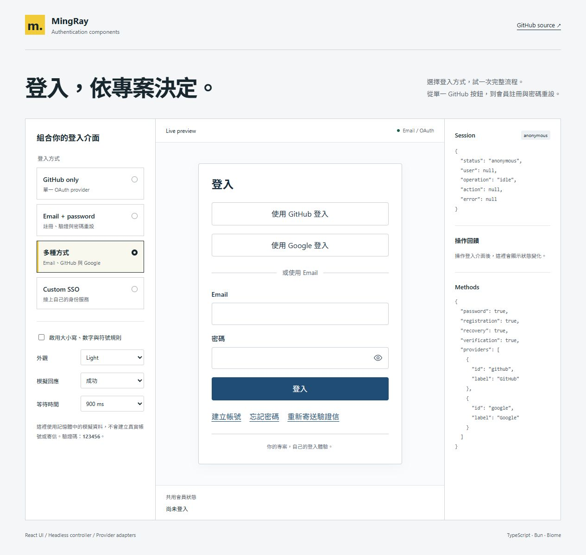

# Web Authentication Component

[English](../README.md) · 繁體中文

把各專案的登入 UI、狀態流程與 provider 接法集中到同一個 package。既有會員資料庫、user ID 與身分服務保留在原專案。

[npm 套件頁](https://www.npmjs.com/package/@ntustray/web-authentication-component)

| 登入組合                     | 設定                                   |
| ---------------------------- | -------------------------------------- |
| 只能 GitHub                  | `methods: githubOnly`                  |
| 只能 Email / password        | `methods: passwordOnly`                |
| Email + GitHub / Google      | `passwordOnly` 加上 `providers`        |
| 自訂 OAuth / SSO / hosted UI | `AuthAdapter` 或 `createHostedAdapter` |

支援 Supabase、Better Auth、Neon Managed Auth，另提供 Clerk hosted/modal bridge。React UI 可整組使用、替換欄位與 icon，或只使用 headless controller。

## 本機試用

1. `bun install --frozen-lockfile`
2. `bun run dev`
3. 開啟 terminal 顯示的 localhost URL。

Playground 可切換登入方式、Light / Dark、密碼字元規則、等待時間及成功／錯誤／429／斷線。它只使用記憶體模擬資料，不會寄信或建立真實會員。驗證碼是 `123456`。



[手機深色註冊畫面](images/playground-mobile.png)

## 安裝

```sh
npm install @ntustray/web-authentication-component
# 或使用 Bun
bun add @ntustray/web-authentication-component
```

本機開發時可在此 repo 建立 tarball，再於另一個專案安裝：

```sh
bun run build
npm pack --ignore-scripts
# 在使用端執行；請換成實際 tarball 路徑
bun add ./ntustray-web-authentication-component-0.3.0.tgz
```

ESM package；Node >=22；React UI 支援 React 18.3 / 19。只使用 core 或 server helpers 不需要安裝 React。CSS 需明確 import，不會自動污染全站樣式。

## GitHub-only：Better Auth

```tsx
"use client";

import { useState } from "react";
import {
  createAuthController,
  githubOnly,
} from "@ntustray/web-authentication-component";
import { createBetterAuthAdapter } from "@ntustray/web-authentication-component/adapters/better-auth";
import {
  AuthPanel,
  AuthProvider,
  AuthStatus,
} from "@ntustray/web-authentication-component/react";
import "@ntustray/web-authentication-component/styles.css";
import { authClient } from "./auth-client";

export function Login() {
  const [controller] = useState(() =>
    createAuthController({
      methods: githubOnly,
      adapter: createBetterAuthAdapter(authClient, {
        providers: ["github"],
        callbackUrl: "/",
        errorCallbackUrl: "/login?error=oauth",
        recoveryUrl: "/login",
      }),
    }),
  );
  return (
    <AuthProvider controller={controller}>
      <AuthStatus />
      <AuthPanel />
    </AuthProvider>
  );
}
```

`AuthProvider` 應放在共用 client layout，讓 navbar 與登入頁讀到同一個 controller。Next.js Server Component 不可把 controller 物件跨 RSC boundary 傳給 client；在 client boundary 建立它。GitHub-only 的 server 必須同時關閉 Email/password，並只設定 GitHub provider。

## Email / password：Supabase

```ts
import {
  createAuthController,
  passwordOnly,
} from "@ntustray/web-authentication-component";
import { createSupabaseAdapter } from "@ntustray/web-authentication-component/adapters/supabase";

// supabase 為既有 @supabase/ssr browser client；siteOrigin 為可信任的 app 設定。
const controller = createAuthController({
  methods: passwordOnly,
  adapter: createSupabaseAdapter(supabase.auth, {
    providers: [],
    password: true,
    registration: true,
    recovery: true,
    verification: true,
    callbackUrl: new URL("/auth/callback", siteOrigin).href,
    recoveryUrl: new URL(
      "/auth/callback?next=/auth/update-password",
      siteOrigin,
    ).href,
  }),
});
```

保留原專案的 PKCE callback、cookie proxy／middleware 與 server `getUser()` 驗證。`AuthPanel initialView="reset-password"` 應由已驗證的 recovery callback 導向；不可單憑 query parameter 當作驗證成功。

## 混合／自訂登入

```ts
const methods = {
  ...passwordOnly,
  providers: [
    { id: "github", label: "GitHub" },
    { id: "google", label: "Google" },
  ],
};
// adapter.capabilities.providers 與真實 backend 必須也啟用這些 provider。
```

自訂 provider ID 不限制品牌；由 adapter 實作 `signInWithProvider(id)`。不支援的 method 會在 config 建立時被拒絕，controller 也會拒絕直接呼叫停用的操作。

## 密碼與防呆

- 新密碼預設 8–128 個字元，以 Unicode code point 計算。支援空白、貼上與密碼管理器。個別專案可在 `createAuthController` 傳入 `passwordPolicy: { minLength: 15 }` 並在身分服務設定相同門檻。
- 可設定大小寫、數字、符號、UTF-8 byte limit、blocklist；預設不強迫字元混合。
- 註冊／重設檢查確認密碼；舊會員登入不套用新的複雜度要求，也不 trim 密碼。
- loading icon、重複送出防護、錯誤 focus、Caps Lock、寄信倒數、逾時與 OAuth popup 取消後恢復。
- 登入成功同步共用會員狀態；登出與帳號變更會使舊的非同步結果失效。
- 逾時後保留 SDK 操作鎖；登出會排隊完成。登出失敗後，背景 refresh 不會重新顯示舊帳號。
- controller／view／reset token 改變時清除表單秘密資料；重寄成功清空舊 OTP。
- snapshot 深層唯讀；custom adapter 的額外欄位與 raw errors 會在邊界清除。事件不保存密碼、OTP、reset token 或 access token。

身分服務或 app 的 server handler 必須執行密碼規則、驗證 session 與資料存取權限。`/server` 提供 scrypt、origin／method guards，以及可串接 rate limiter 與單次 recovery token store 的介面。[安全責任與設定](../SECURITY.md)

## 切換語言

`AuthProvider` 支援繁體中文（`zh-TW`）、英文（`en`）、日文（`ja`）。預設繁體中文。將網站目前的語系傳給 `locale`，登入面板、會員狀態、錯誤訊息、等待狀態與無障礙標籤就會跟著切換。

```tsx
<AuthProvider
  controller={controller}
  locale="zh-TW"
  messages={{ errors: { unavailable: "目前無法登入，請稍後再試。" } }}
>
  <AuthStatus />
  <AuthPanel />
</AuthProvider>;
```

新增語言時，將對應的語言代碼傳給 `locale`，翻譯放入 `messages`。尚未內建的語系會用英文補齊缺少的翻譯。請保留 `{min}`、`{seconds}`、`{provider}` 等參數。可用 `AuthLocaleProvider` 設定局部語系，或用 `useAuthLocale()` 在自訂元件取得翻譯。Provider 名稱、自訂通知與身分服務寄出的信件由專案設定。

## 外觀與介面

```tsx
<AuthPanel
  theme="dark"
  locale="zh-TW"
  className="my-product-auth"
  slots={{
    header: <Logo />,
    footer: <Terms />,
    providerIcon: renderProviderIcon,
  }}
/>;
```

可用 CSS variables 覆蓋顏色、圓角、動畫時間；`slots.field` 替換輸入欄位；不載入 CSS 並使用 `unstyled` 可自行排版。`useAuth()`、`AuthField`、`PasswordField`、`AuthButton`、`AuthFeedback`、`AuthStatus`、`AuthGate`、`SignOutButton` 可分開組裝。支援 `prefers-reduced-motion`。[完整 props](API.md)

## 文件與驗證

- [專案接法與遷移狀態](MIGRATION.md)
- [多輪 review 與回歸修正](REVIEW.md)
- [Public API](API.md)
- [架構與 session 流程](ARCHITECTURE.md)
- [Code graph](CODE_GRAPH.md)／[JSON graph](code-graph.json)
- [AI 修改指南](../AGENTS.md)／[llms.txt](../llms.txt)
- [npm 發布](PUBLISHING.md)

```sh
bun run format
bun run graph
bun run verify
```

測試涵蓋 controller 競態、真實 SDK type compatibility、React 表單互動、server hash／recovery／origin boundaries。線上 OAuth、SMTP 寄送與各專案資料授權需在各自的 staging 驗證；package 測試不會改動線上帳號。
