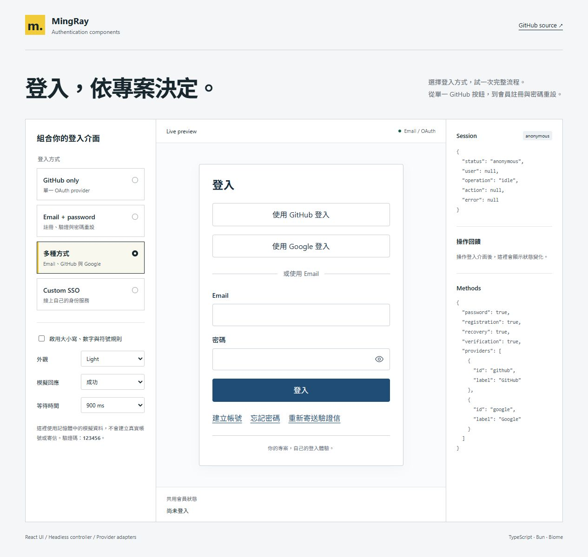

# 驗證紀錄

## 2026-11-09 發布檢查

- CLI 已以 ntustray 授權，npm 11.15.0 staging 已上傳並通過自動檢查。
- 2026-11-09 20:32（Asia/Taipei）完成正式發布；公開 registry 的 0.2.0 與 latest 已確認。
- 從 npm 下載的實際 tarball SHA-1：d11153eb893f9ea36368f47c1ef399041a3f79ee。
- 公開 tarball 的 SHA-1／SHA-512 integrity 與 stage 一致。
- 全新 consumer 從公開 registry 指定 0.2.0 安裝；無 React 的 core／server／adapters、CSS export、React 18.3.1／19.3.1 SSR 均通過。

## 2026-11-08 實作基線

日期：2026-11-08。Package version：0.2.0；此為發布前的實作基線，正式發布結果見上方 2026-11-09 紀錄。

| 項目                                 | 本機結果                                                                            |
| ------------------------------------ | ----------------------------------------------------------------------------------- |
| Biome / strict TypeScript            | 通過                                                                                |
| Vitest                               | 102 個 behavioral tests（新增 43 個 review regressions） 通過                       |
| 多輪 review                          | Terra 與另一位 sub-agent 獨立檢查；由主要 agent 重現修正，見 [REVIEW.md](REVIEW.md) |
| SDK type contracts                   | Supabase 2.118.0、Better Auth 1.7.18、Neon JS 0.10.2 通過                           |
| ESM / declarations / client boundary | build 與 dist smoke 通過                                                            |
| Code graph                           | 21 modules、233 nodes、550 edges；freshness 通過                                    |
| Playground production build          | 通過，無 client-directive warning                                                   |
| 安裝 tarball                         | 獨立 consumer 安裝成功；core / server / adapters 只安裝本 package                   |
| React 18                             | 從 tarball 安裝 React 18.3.1 後 SSR smoke 通過                                      |
| React 19                             | React 19.3.1 的 forms、SSR 與完整測試通過                                           |
| npm pack 內容                        | 沒有環境檔、node_modules、測試／模擬 identity adapter                               |
| 既有桌機 / 手機基線                  | Light / Dark、單一 provider、註冊／Email code flow、共用會員狀態通過手動檢查        |
| 手機橫向 overflow                    | 390 × 844 viewport 下 document clientWidth 與 scrollWidth 同為 375，沒有橫向溢位    |

桌機／手機截圖為 0.1.0 視覺基線；本輪未變更 CSS，互動修正以 React DOM regressions 驗證。

GitHub CI 另以 Ubuntu + Node 24 執行 React 18.3.1 / 19.3.1 matrix。結果以 [Actions](https://github.com/ntustRay/web-authentication-component/actions) 的實際 run 為準。

[手機深色註冊畫面](images/playground-mobile.png)

## 未執行的線上行為

- 沒有寄送真實驗證信、建立真實會員或測試各站 production OAuth。
- 沒有搬移帳號、修改線上資料庫／RLS／provider 配置。
- 現有專案尚未安裝此 package 或切換 production auth。
- Trusted Publisher 尚未配置；本次首版透過本機 staging 與維護者 2FA 完成，不宣稱 GitHub provenance。

這些不是 package unit tests 能代替的驗證，切換步驟見 [MIGRATION.md](MIGRATION.md)，發布步驟見 [PUBLISHING.md](PUBLISHING.md)。
